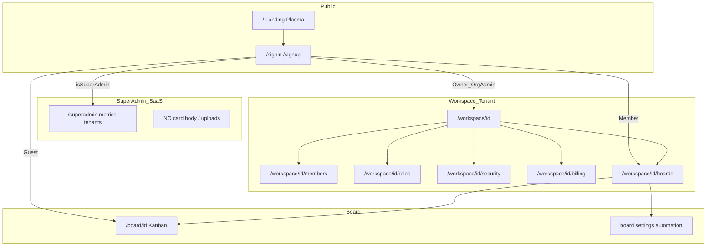

# ROLE_ACCESS_MAP — ENTERHUB User Management

چارت و جدول مرجع برای تست دستی هر نقش. Permissionها: `frontend/src/lib/permissions-catalog.ts`.

## Flow

## Role summary

| نقش | مسیرهای اصلی | قابلیت‌ها | ممنوع |
|-----|---------------|-----------|--------|
| Super Admin | `/superadmin/*` | متریک SaaS، تعلیق Tenant، audit امنیتی | متن کارت / فایل کاربران |
| Owner | `/workspace/[id]/*` | همه + transfer ownership + delete | infra سرور |
| Org Admin | members, roles, security, billing, boards | اعضا، نقش، ۲FA، فاکتور | transfer_ownership |
| Board Admin | بورد + settings | custom fields، automation، webhook، guest | billing / roles سازمان |
| Member | boards + My Tasks | کارت، DnD، کامنت، تایم‌شیت | invite سازمان، ماتریس نقش |
| Guest | فقط بورد دعوت‌شده | READ_ONLY / COMMENT_ONLY / ASSIGNED_ONLY | بوردهای دیگر، اعضای کل org |

## Route × Role × Permission (ایندکس)

| Route | Super | Owner | OrgAdmin | BoardAdmin | Member | Guest |
|-------|-------|-------|----------|------------|--------|-------|
| `/` marketing | ✅ | ✅ | ✅ | ✅ | ✅ | ✅ |
| `/signin` | ✅ | ✅ | ✅ | ✅ | ✅ | ✅ |
| `/superadmin/*` | ✅ `isSuperAdmin` | ❌ | ❌ | ❌ | ❌ | ❌ |
| `/workspace/[id]` | ❌* | ✅ | ✅ | ✅ | ✅ | محدود |
| `/workspace/[id]/members` | ❌* | `workspace:members` | `workspace:members` | ❌ | ❌ | ❌ |
| `/workspace/[id]/roles` | ❌* | `workspace:roles` | `workspace:roles` | ❌ | ❌ | ❌ |
| `/workspace/[id]/security` | ❌* | `security:policies` | `security:policies` | ❌ | ❌ | ❌ |
| `/workspace/[id]/billing` | ❌* | `workspace:billing` | `workspace:billing` | ❌ | ❌ | ❌ |
| `/workspace/[id]/boards` | ❌* | ✅ | ✅ | ✅ | ✅ | ❌ |
| `/board/[id]` | ❌* | ✅ | ✅ | ✅ | ✅ | ✅ فقط دعوت |
| `/board/[id]/settings` | ❌ | `board:settings` | `board:settings` | `board:settings` | ❌ | ❌ |

\* Super Admin عمداً به محتوای tenant وارد نمی‌شود مگر Impersonation (فاز ۸.۳، read-only + audit critical).

## صفحات محصول ساخته‌شده (Coreinet glass + Safe*)

| مسیر | المان / الگو |
|------|----------------|
| `/workspace/[id]` | SafeStatsRow + SafeActivityFeed |
| `/workspace/[id]/boards` | کارت‌های glass (SafeProjects feel) |
| `/workspace/[id]/my-tasks` | SafeTasks |
| `/workspace/[id]/members` | جدول + invite |
| `/workspace/[id]/roles` | ماتریس permission |
| `/workspace/[id]/security` | SafeSettings-style form → API |
| `/workspace/[id]/billing` | SafeAccountBilling |
| `/workspace/[id]/audit` | جدول audit |
| `/workspace/[id]/team` | SafeTeamPage |
| `/board/[id]` | BoardKanban (SafeTasks DnD + API) |
| `/board/[id]/settings` | تنظیمات + guests |
| `/superadmin` | SafeStatsRow + metrics API |
| `/dashboard` | کاتالوگ کامل SafeDashboard (دمو) |

---

## UI component reuse (Coreinet)

| صفحه | کامپوننت |
|------|-----------|
| Shell | SafeDashboard, SafeSidebar, SafeTopbar, glassStyle |
| Members | SafeTables, SafeTeamPage |
| Roles | SafeSettings, SafeCheckboxesRadios |
| Forms | SafeFormLayouts, ui/dialog, ui/button |
| States | empty-result, error-result, success-result |
